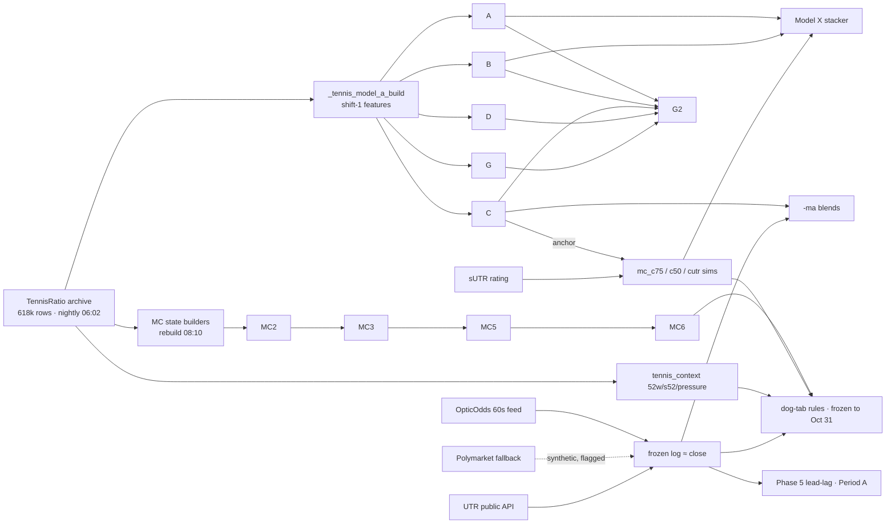

# Tennis Model Technical Audit (2026-10-19)

Inspection-only. Evidence = code at commit `273e6db`, stored artifacts, and the Phase 1–4 audit
measurements (clean forward rows unless stated). **V** = verified in code/data this session,
**M** = measured result, **A** = assumption / not verified. Nothing was modified; Period A and
the Oct 31 checkpoint untouched.

---

## 1. Model-by-model architecture

### 1.1 Statistical heads (one module: `backend/tennis_model_a.py`, artifacts in `model_artifacts/`)

| head | type (V) | features | target | market use | calibration (M, clean fwd) |
|---|---|---|---|---|---|
| **A** | LogisticRegression(C=0.5) + XGB(300 trees, depth 4, lr .05, sub .9, col .8) on 15 diff features (`FEATURES`, line 28; trainer line 1305) | mixed windows: `d_sr10,d_l10,d_l20,d_swin,d_sgw,d_rgw,d_sp,d_rp,d_oppq,d_v100,d_rust,d_lrank,f_h2h_n,f_h2h_share,f_h2h_s_share` | match winner | none (the `-ma` sibling adds market, below) | slope 0.76 (0.46 on first half), AUC .603 — weakest head; **retired from decisions (Phase 4)** |
| **B** | same harness | 10 last-10-on-surface features incl. rank-adjusted who-beaten/lost (`FEATURES_B`, line 163) | winner | none | slope 0.90, AUC .636 |
| **C** | same harness | full 52-week-on-surface profile + season + rank-band matchup + last-10 + H2H (26 features == 35 by ablation, M 10-10) | winner | none | **slope 0.65 — worst-calibrated head**; predicts 84%→wins 74%; AUC .654. Feeds C75/CMA/X. |
| **D** | same harness | heavy last-10 form: surface+overall recent win rates, form vs own 52w baseline, top-150 competitiveness, scalp quality, `ewd` serve/return block (line 39) | winner | none | slope 0.81, AUC .666 |
| **G** | same harness | opponent-rank-ADJUSTED 52w stats; the only count-aware family (`d_matches,f_nmin,f_wide`) | winner | none | slope 0.99, AUC .670 (wf .6546–.6597 by year, V header) |
| **G2** | G + `t10_*` last-10-on-court block (record, who beaten/lost, best win/worst loss, games share, hold/brk, closeness; walkovers excluded structurally) (line 93) | winner | none | slope 0.97, AUC .678 (wf beats G all 3 years, V header) |
| **`-ma` siblings** (ama/bma/cma/dma/gma/g2ma) | per-head logistic `lr_ms` on `[logit(market), X]` (predict(), ~line 664) | winner | **yes, directly** | CMA AUC .700 — still below market .714 (M) |
| **sUTR** | court-specific games-share rating, recency-weighted last 30 on surface, opponent-adjusted by construction (line 60) | rating (anchor input) | none | single-stat AUC .675–.684 by year (V header); used as MC anchor, not a head |

### 1.2 Sampled Monte Carlo family (`tennis_model_a.py` ~1150–1300): `mc` (D-MC), `mc_c`(=c50), `mc_c75`, `mc_cutr`

- **True sampled simulation** (V): per-point serve-win probs from recency-weighted serve stats vs
  opponent return stats, opponent-adjusted `(sv − (rt − (100−AV_SV)))/100`, clipped [.35,.85];
  tour-average serve `AV_SV` = 61.0 men / 56.5 women; exact game/tiebreak/set math; randomness
  drawn **at set level** with per-sim form noise `SIGMA = 0.04`; **seeded by matchup**
  (`crc32(s1|s2|surface|anchor)`, line 1266) so numbers are stable between refreshes — reproducible,
  not an uncertainty estimate. Sim count is a call parameter (the 100k-sim spike caused the
  2026-10-02 OOM; M).
- **Anchors compose** (V, line ~1220): (1) sUTR games-share shrink weight 0.5 (strength-of-schedule
  fix), then (2) Model-C match-prob anchor via bisection on a point-prob offset.
  `c50` = C anchor only; **`c75` = harder C pull; `cutr` = C + stronger sUTR shrink**. So
  **C75 ≈ a serve-dynamics repaint of Model C** — the ρ=0.95 correlation and inherited
  miscalibration are architectural, not coincidental.

### 1.3 Analytic Markov family: MC2 → MC3 → MC5 → MC6 (separate modules + state files)

**Not simulations — closed-form** (V `tennis_mc2.py`):
- Exact recursive set-score distribution (`_set_dist`, serve alternation, 7-6 via tiebreak prob),
  closed bo3 (`s²+2s²(1−s)`) and bo5 (`s³(1+3q+6q²)`); `distribution()` refuses bo5 shapes (V).
- Ratings state (`data_cache/_mc2_state.pkl`, rebuilt nightly 08:10 UTC by
  `tennis-ratings-rebuild.timer`, V): Elo (binary K in MC2 — kept as control) + opponent-adjusted
  serve/return deviations learned sequentially from the archive.
- `predict()` (V, line 183): per-player point-prob uncertainty σ = 0.10/√nS integrated by
  **quadrature** (`_NODES`), surface-shrunk Elo (`w = ns/(ns+20)`, 0.7 career + 0.3 shrunk-surface),
  **blend = logistic(0.5·logit(Elo) + 0.5·logit(Markov) + asym_tilt)**, `MC_TILT=0.35` log-odds
  nudge away from the thinner sample (M: thin side was +10pt overrated; shrinkage made it worse).
  Gate nS ≥ 4. Deterministic; no RNG.
- **MC3** (V header): + per-surface S/R shrunk to career (`KS=20`), bo5 bug fix, margin-aware Elo
  (K scaled by games margin, `MOV_W=1.5`). AUC .6677→.6716, Brier →.2275 (M archive).
- **MC5** (V header, unusually honest): + surface-L5 (weights 0.10 results / 0.03 serve),
  season-on-surface EB (raised to 0.50 — the one real win), clutch — **each measured
  neutral-to-worse vs MC3 before shipping at minimal weights, on user call**.
- **MC6** (V `tennis_mc6.py`): logit(MC5) + 0.25·recentH2H (365-day half-life, damped w/(w+1),
  games-margin component) + 0.50·surface-form **residual** (5-match-HL EWMA of result −
  Elo-expected, differenced). Weights measured on 170k archive rows *before* the module was
  written; the gain is the surface-form term, H2H ≈ 0 (V header + memory).
- Calibration (M): MC2 slope 1.07 (best), MC3 0.93, MC5 0.90, MC6 0.86; market stays ahead on AUC.

### 1.4 Meta / betting models

- **X** (`tennis_model_x.py`, V): logistic stacker C=0.3 over market-free logits (A, B, MC, MCC,
  c75, cutr) + spreads + league/surface/round flags; market **removed 2026-10-09** (previously
  copied the price); nightly expanding walk-forward gate auto-adds candidates (≥150 OOS rows,
  ≥.003 logloss gain). **M: takes a negative weight once the market is controlled — retired.**
- **P** (`tennis_model_p.py`, V): profit/offset model for dogs/favs to ±500 (`train(lam=2.0)` on
  prepared rows; features `d_vs_band, g_C, g_gray, g_Dma, d_form_win, d_m_perf, d_m_won, d_sutr,
  d_lrank, is_chall, is_itf`); gender-banded; retrained (not ungated) on the widened band. Not
  logged as a probability column; board chips only.
- **Signal columns, not models** (V): `s52_sgw/rgw` (52w surface games-won, frozen at first
  serve; as-of backfilled), `pf_edge` (pure-form, standalone refuted), `utr_edge/utr_mom`
  (UTR public API, forward-only), opener flags, pressure dials.
- **Retired architecture** (V): `tennis_model.py` + `tennis_features.py` — the original
  chronological Elo/form tour model (clean harness); `p1_win_prob` mostly null since 2026-09-28.
- **Execution ledgers (not predictors)**: paper auto-bettor; Phase 5 lead-lag engine.

### 1.5 Selection rules currently painting (V, frozen)

Dog tab pink: MC6 ≥2pt (men +100-150, +201-250), MC6 ≥3pt (women +100-150/+151-200/+251-300),
s52 fav-band dog (+100..+200), c75 flip (men +100-150). Gold: MC6 women ≥6pt+EV, men 3-6pt+EV,
−150..−200 band rules, 4pt lanes at −100..−200. All pre-registered to the Oct 31 close;
**Phase 3 measured none surviving out of sample so far.**

---

## 2. Feature dictionary (by source; cadence and availability are the leakage story)

### 2.1 TennisRatio archive (`data_cache/tennisratio/all_match_logs.parquet`)

**V:** 618,507 rows, 2000→today, 61 columns, **only 1,760 players** (ingested on demand —
survivorship), **0 retirement markers** (structural inference via `tennis_score.py`), nightly
site ingest 06:02 UTC + ratings rebuild 08:10 UTC. **M:** site stat lines reach only 37–55%
same-day (results themselves come same-day from TE/PM). Availability: a feature computed from
last night's archive is point-in-time **as of yesterday**, not as of first serve.

| family | examples (exact names) | definition (V from `_tennis_model_a_build.py` — every window is `shift(1)` then rolling, strictly pre-match) |
|---|---|---|
| recent form | `d_l10,d_l20,t10_win,d_form_win` | last-10/20 won-rate diffs, surface and overall; min counts 3–6 |
| serve/return windows | `d_sr10,d_sp,d_rp,d_sgw,d_rgw` | last-10-on-surface 1st/2nd serve pts (0.6/0.4), return pts (0.5/0.5), service/return games won |
| 52-week profile (C/G) | `d_swin`, s52 blocks, G's rank-adjusted versions | 52w-on-surface windows; G divides by opponent-rank expectation |
| opponent quality | `d_oppq,d_v100,t10_faced/beaten/lost,t10_bestwin/worstloss` | median rival rank (last 10), top-100 record, log-rank of scalps |
| schedule | `d_rust` (`days_off`, capped 120) | days since last match — the only rest/fatigue feature in any head |
| H2H | `f_h2h_n,f_h2h_share,f_h2h_s_share` | career counts/shares (+ surface); MC6 adds the recency-weighted version |
| ratings | Elo / surface-Elo / S,R deviations (MC state), sUTR | sequential from the archive; MC3+ per-surface with K=20 shrink |
| rankings | `d_lrank`, `rank_proxy` | log official rank; proxy = latest rank opponents' rows report (V line 433 — can be stale for inactives) |

**Missing-data handling (V):** features `fillna(0)` into LR/XGB (A/B/C/D/G); MC gates on nS≥4;
sUTR anchor needs n≥5 per side; C-serve stats fall back to another surface when the played
surface has none (the Golovina fix); UTR/pure-form imputed as coin-flip logit 0 in X (never the
market).

### 2.2 Odds & market

**V:** `p1/p2_odds` = frozen pre-match price (bookmaker column; FanDuel-dominant), ≈ the close
(M: median 0.81pp from Pinnacle's close, unbiased); `open_*` = our first-seen quote, never
overwritten; venue `quote_ts` on every OpticOdds quote; Phase 2 flags (`price_synthetic`,
`price_poststart`) gate every lane. Polymarket-fallback mirrors are flagged synthetic.
**The Odds API (subscribed, V key tested 10-11): historical 5-minute odds grid back to mid-2024
incl. Pinnacle — stored capability, currently unused by any model.**

### 2.3 Post-match columns (never features — V grep: only log display/post-mortem read them)

`ue_p1/ue_fh_p1/ue_set5_diff_p1` (n=40–110), `aces/df/sgames`, `score`, `win_p1` (all-NaN
duplicate of `p1_won` — a trap that cost one audit script a day).

### 2.4 Redundant / leaky / stale / low-coverage (M unless noted)

- **Redundant clusters:** MC2–MC3–MC5–MC6 ρ .95–.99 (one state lineage); C~C75 .95
  (architectural, §1.2); G~G2 .94; X≈.88 with C/D. **Effective independent signals ≈ 4.**
- **Leaky:** none found in any training path (Phase 1 §2b). Post-match columns exist but are not
  consumed. Recon rows (mc2 48%, mc3 77%, mc6 70% of settled) are display-only; the recurring
  leak risk is analyses that forget the `*_recon` flag.
- **Stale:** Pinnacle via the 60s feed (minutes–hours, Phase 5 R3) — fine for the frozen close,
  useless for timing; `rank_proxy` staleness for rarely-seen players (A).
- **Low coverage:** UE (40), UTR (~600 rows), `model_cnohb/capi` (543), ITF context (91% of ITF
  players have no 52w stats — M 10-11); grass/carpet absent from the live window.

---

## 3. Training & validation audit

| item | finding |
|---|---|
| data span | archive 2000→today; walk-forward reporting years 2024/2025/2026 (V headers) |
| splits | **chronological everywhere** (V): A/B/C/D/G features `shift(1)`-built; X expanding-window OOS; MC states sequential; retired tour model single chronological pass; P retrained walk-forward on the widened band (memory 10-13) |
| target / balance | `p1 won`; two-sided row construction ⇒ exact 50/50 class balance (V) |
| hyperparameters | fixed, minimal: LR C=0.5 (heads) / C=0.3 (X), XGB 300×4×0.05×0.9×0.8, P λ=2.0; no tuning loops found (V) |
| test-period contamination | **models**: MC5/MC6 term weights were chosen on the same held-out years they're reported on (V, stated in their headers — optimistic by their own admission). **Rules**: every board threshold was scanned in-sample (Phase 1 §2c) — the dominant contamination lives in selection rules, not model fits. The Oct 31 window is the pre-registered cure. |
| headline OOS metrics (clean fwd, M) | market AUC .714 / Brier .2149; best market-free mc2 .679/.2253; model_cma .700/.2223; every head worse than market on identical rows; Phase 4: **zero heads add OOS information after market control** (best t=+1.0; MC5 harmful t=−2.35) |
| segments (M, Phase 1 §7 + audits) | favourites lose −7.2% blind (≈vig; market accurate to 0.8pt); women's dogs ≈0 (+1.6pt market error); ITF least bad for favs; hard −7.6/clay −5.6; weekly drift −12→−8% in October; by coverage tier: MC gates at nS≥4, G-family the only count-aware heads |
| class of errors | overconfidence concentrated **where a head disagrees with the market** (C75 anatomy, Phase 4 §3: −17pt to +22.5pt monotone in disagreement; amplified ITF/clay/+300 dogs) |

## 4. Monte Carlo implementation (direct answers)

- **Inputs/distributions:** sampled family — per-point serve probs from recency windows,
  opponent-adjusted, set-level Bernoulli draws + N(0, 0.04) form noise per sim; analytic family —
  point probs from rating state, **no sampling**, exact Markov recursion, uncertainty via
  quadrature with σ=0.10/√nS per player.
- **Counts/seeds:** sampled family seeded `crc32(matchup|surface|anchor)` (stable between
  refreshes; V line 1266), sim count per call (100k spike → the Oct-2 OOM; now capped by
  callers). Analytic family deterministic.
- **Serve→game→set→match:** exact closed-form in both (`_p_game/_p_tb/_set_dist/p_match`); bo5
  correct since 10-13 (the slam bug fix); `distribution()` deliberately refuses bo5.
- **Limited samples:** nS≥4 gate; σ shrinks with √nS; surface shrink ns/(ns+20); `asym_tilt`
  (0.35) for sample asymmetry — a measured patch, not a posterior (opportunity #2 below).
- **Validation:** archive walk-forward (blend .692 AUC, ~1pt/decile calibration), anchored twin
  validated on 65,723 real score lines (set-score LL/TB Brier/totals), live decile table
  (Phase 1 §B), as-of recon rebuilds after the state-contamination incident. **Independently
  validated against observed outcomes: yes, and it loses to the market on identical rows.**

## 5. Reconciliation with Phases 1–4

- **Why no head beats the market:** every head is a compression of the same public TennisRatio
  statistics (plus Elo derived from the same results) that the books also price. §2 shows there
  is no input in any head the market plausibly lacks. The residual after market control is
  therefore estimation noise — exactly what Phase 4 measured (all Δlogloss ≤ 0).
- **Why the heads duplicate:** one archive → one state lineage (MC2→3→5→6 are nested edits);
  C75 is literally C-anchored (§1.2); G2 ⊃ G; X stacks the others. The correlation matrix is the
  dependency graph made visible.
- **Why disagreement with the market fails / C75's overconfidence:** disagreement = the model's
  idiosyncratic estimation error, since shared information is already in the price. Symmetric
  reversion-to-market in the C75 anatomy (both directions) is the signature of noise, amplified
  where samples are thin (ITF, clay, long odds) and by C's slope 0.65, which C75 inherits
  through the anchor. Recalibration can't help because the defect is discrimination
  (market-conditional), not scaling — proven by the honest half-split test.
- **Dispositions (user-ratified):** benchmarks = market, MC2, G/G2; retired from decision paths =
  A, MC5 (in combination), X; everything else labelled "no incremental information", visible only.

### Dependency diagram

---

## 6. New-information opportunities — ranked, with experiments

Ground rule from Phase 4: only **new information** (or honest uncertainty) can move anything;
re-blending §2 features cannot. Bar for all: nested walk-forward Δlogloss vs the recalibrated
market on identical valid rows, pre-set t≥3, then an untouched later window. None of these touch
Period A.

**#1 — Verified openers + timestamped market movement (The Odds API historical grid).**
*Hypothesis:* the path of the price (open→T drift, cross-book dispersion, Pinnacle-vs-soft gaps
at T−x) carries information a single frozen close lacks (prior evidence: fav drifted 8pt+ ⇒ +7%
at close on 19k PM matches). *Data:* already subscribed, 5-min grid to mid-2024 incl. Pinnacle —
the only candidate with ~100k-row backtest fuel on day one. *Coverage:* tour+challenger high (A:
exact per-league coverage to be measured first). *Leakage risk:* low — every quote timestamped;
features restricted to grid points ≤ decision time. *Experiment:* build as-of drift features on
the historical grid; `y ~ logit(close) + drift-features`, expanding WF by season; success =
Δlogloss t≥3 in 2025 AND 2026 test years separately.

**#2 — Hierarchical player-strength uncertainty (posterior σ per player).**
*Hypothesis:* MC2's σ=0.10/√nS and the MC_TILT patch approximate what a real posterior would do;
proper partial pooling (league-level priors, per-player posterior sd into the quadrature) fixes
thin-sample calibration where every head is worst (ITF/clay/long odds). *Data:* none new — the
archive. *Leakage:* none (sequential fit). *Experiment:* state-builder variant (separate state
file, MC2 untouched); judge on calibration slope **per nS-decile** and Brier, WF by year;
success = slope within ±0.05 of 1.0 across deciles without AUC loss. Improves probability
quality even if the market stays unbeaten.

**#3 — Same-day raw point counts (Goalserve challenger feed + RapidAPI stat lines).**
*Hypothesis:* the archive's 37–55% same-day stat coverage makes every "recent form" feature
stale by 1–3 days; same-day raw serve/BP counts restore the freshest window, where books are
laziest at challenger/ITF-W. *Data:* Goalserve ingest exists (quarantined, V: 107
challenger matches same-day); RapidAPI key verified for same-day full stat lines. *Coverage:*
challenger good, ITF partial (A: measure). *Leakage risk:* medium — must be ingest-timestamped
and used strictly as-of; never backfill. *Experiment:* freshness feature (Δ between same-day
counts and archive window) added to market+MC2; WF Δlogloss, challenger segment pre-specified.

**#4 — Pre-match availability/fatigue: schedule density + structural retirement risk.**
*Hypothesis:* matches-in-last-7d, sets played, B2B tournaments, and opponent's recent-retirement
signature are mispriced at lower tiers; also directly improves EV via retirement/void
probability (we settle retirements as losses at PM/Kalshi). *Data:* computable from the archive
today (`days_off` is the only current fatigue feature); travel needs a tournament-geo table
(A: buildable, ~200 venues). *Leakage:* low (schedule is pre-match fact). *Experiment:* two
targets — (a) winner: WF Δlogloss vs market; (b) retirement incidence model (base rate ~4%),
judged on its own calibration; only (a) gates any selection use.

**#5 — Gender/segment calibration layers + WTA feed coverage.**
*Hypothesis:* every phase found gender structure (serve/hold gaps, band asymmetries); per-gender
(and per-tier) recalibration of MC2/G2 is the cheapest probability-quality gain, and WTA is
absent from the OpticOdds league list entirely (V), so half the slate has no sharp/exchange feed.
*Data:* none new for the calibration; one config-line league addition for WTA — **after Period A**
(frozen now). *Leakage:* calibration fitted on earlier data only. *Experiment:* WF per-segment
Cox layers on MC2; success = per-segment slopes →1.0, Brier non-worse; WTA feed addition gets
its own coverage probe before anything consumes it.

*Explicitly not recommended:* UE-based features (post-match timing, 40-row coverage, every
retro test clay-confounded or refuted); more heads on the same archive; consensus mechanisms
(refuted four times).

---

### The five deliverables, mapped
1. Architecture report — §1. 2. Feature dictionary — §2. 3. Training/validation audit — §3
(+§4 for the MC engines). 4. Dependency diagram — §5. 5. Ranked opportunities + experimental
designs — §6.
